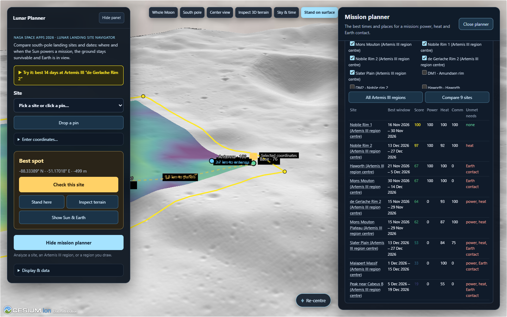

# Lunar Planner

**Find when and where a Moon south-pole mission stays powered, warm and in touch with Earth.**

NASA Space Apps Challenge 2026 · Challenge: **Lunar Landing Site Navigator** · Team **TheBlackTiger**

🎬 **[30-second demo video](https://youtu.be/oEgPhaKdJdY)** · 🚀 **[Run it yourself](#run-it-yourself)**


## The problem

At the Moon's south pole, where NASA's Artemis astronauts will land, the Sun stays within a few
degrees of the horizon: it skims the skyline, crater rims cast shadows for days, and Earth keeps
dipping behind the terrain. A mission needs sunlight for power, survivable temperatures, and Earth in view to
communicate, and all three change with **where** you land and **when**. The tools that give Sun and
Earth positions exist, but they are hard to use and do not answer the planner's real question.

## What Lunar Planner does

- **Finds the best mission windows.** Give a search period (up to 6 months) and a mission length;
  every possible window is scored and the best are ranked, with a chart of the score over time.
- **Says plainly whether each window works.** A verdict lists every unmet need in numbers, for
  example "darkness lasts 50 h, battery covers 30 h". Windows that meet every need always rank first.
- **Places the equipment.** For a region, it finds the best spot for the **base**, for the **solar
  panels** and for the **antenna**, with distances, and can keep them within a cable length.
- **Maps it on a real 3D Moon.** A smooth, coloured score surface is draped over NASA's 5 m terrain,
  with lines joining the base to its panels and antenna.
- **Shows the Sun and Earth against the real horizon.** A horizon chart draws the terrain skyline
  with the Sun's and Earth's paths over the window, faded where terrain hides them.
- **Compares sites side by side.** All 9 NASA Artemis III candidate regions, the PGDA south-pole
  sites and your own pins, ranked by whether they meet every need.
- **Lets you stand on the Moon.** Street-level view at any spot: walk around, then use **Sky & time**
  to play the sky forward and watch the Sun circle the horizon and Earth rise and set.
- **Simple to drive.** Three plain choices (power, heat, Earth contact) with optional advanced
  settings, a one-click demo, CSV/JSON download, and a layout that works on phones.

## How it meets the challenge

| The challenge asks to… | In Lunar Planner |
|---|---|
| Compare landing sites | Pick any PGDA south-pole site, your own pin, or one of NASA's 9 Artemis III candidate regions. **Compare sites side by side** ranks several at once; a region search ranks every spot inside it and draws a coloured score surface on the Moon. |
| Compare dates | Give a long period (up to 180 days) and a mission length: the planner scores every window and lists the best, with a chart of the score through the period. |
| See the Sun and Earth relative to the horizon | A **horizon chart** draws the real terrain skyline (LOLA, 5 m near the site) with the Sun's and Earth's tracks over the window; **Stand here** puts you on the ground with **Sky & time** to play the sky forward. |
| Assess power | Energy from sun-tracking or fixed panels against the energy the mission needs, and the longest darkness against the battery. |
| Assess direct-to-Earth contact | Share of time Earth is in view from the antenna, and the longest blackout. |
| Be intuitive | Three plain choices (power, heat, communication), a one-click demo, and a verdict that says in words whether every need is met and why not. |

## A 30-second tour

1. Open the app ([run it yourself](#run-it-yourself)): it starts over the south pole.
2. Press **▶ Try it: best 14 days at Artemis III "de Gerlache Rim 2"**. The planner searches the next
   60 days in about half a minute.
3. Read the verdict at the top: does any window meet every need, and if not, what fails (for example
   "darkness lasts 52 h, battery covers 30 h").
4. Look at the Moon: the coloured surface shows where in the region it is best; dashed lines join the
   base to its solar panels and antenna, with distances.
5. Look at the horizon chart: gold dots are the Sun, blue dots Earth, faded where terrain hides them.
6. Press **Fly to the base**, then **Stand here** and **Sky & time**, and press Play.

| Sun and Earth against the real horizon | All 9 Artemis III regions side by side | Standing on the rim |
|---|---|---|
|  |  |  |

## How to read a result

- **✓ / ✗ meets all needs** is strict: every need (power, heat, communication, slope, cable length)
  must be met in full by the base and the panel and antenna spots it can reach.
- **Score 0–100** shows how close: each need scores 0–100 (100 when met, falling to 0 at twice its
  limit) and the window score averages the base's heat with the best panel and antenna spots.
- Windows that meet every need always rank above ones that do not.
- All thresholds are illustrative screening values, not agency requirements.

## Data and models

| | Source |
|---|---|
| Terrain | NASA PGDA product 81 (LOLA south-pole 5 m mosaic, 87–90°S); global LOLA LDEM_16 beyond |
| Named sites | NASA PGDA product 78 south-pole regions |
| Candidate regions | NASA Artemis III candidate landing regions (2024), digitized from NASA's map (a few km accuracy) |
| Sun and Earth | NAIF SPICE DE440 (offline, for the planner and horizon chart); JPL Horizons (live, for the globe and Sky & time) |
| Surface temperature | 1-D regolith model, Hayne et al. 2017 (JGR Planets 122) |
| Earth image | NASA Blue Marble (illustrative) |

Panels and antenna are evaluated 2 m above the ground by default (the nearest bumps would hide a
sky seen from 0 m); the heat model uses the ground itself. Earth contact is geometric line of sight
to Earth's centre, not a radio link or a DSN schedule. The heat model has no light or infrared from
nearby terrain, so permanently shadowed floors read about 10–30 K too cold.

Panels and antenna are evaluated 2 m above the ground by default (the nearest bumps would hide a
sky seen from 0 m); the heat model uses the ground itself. Earth contact is geometric line of sight
to Earth's centre, not a radio link or a DSN schedule. The heat model has no light or infrared from
nearby terrain, so permanently shadowed floors read about 10–30 K too cold. The Sun and Earth
directions were checked against JPL Horizons (agreement to about 0.00001°).

**Built with:** Python (FastAPI, NumPy, SpiceyPy, Shapely, rasterio), TypeScript, React, CesiumJS,
PostgreSQL and Docker; tested with pytest and Vitest (about 160 backend and 100 frontend tests).

## Run it yourself

You need **Git**, **Python 3.11+**, **Node.js 20.19+ or 22.12+**, **Docker Desktop** (for the
database) and about **8 GB** of free disk space for the NASA terrain. Commands are for Windows
PowerShell; macOS/Linux differences are noted after the steps.

**1. Get the code**
```powershell
git clone https://github.com/noorhonjol/NASA-challenge.git
cd NASA-challenge
```

**2. Start a local database** (PostgreSQL in Docker) and create its tables
```powershell
docker run -d --name lunar-db -p 5432:5432 -e POSTGRES_USER=lunar `
  -e POSTGRES_PASSWORD=local_dev_password_change_me -e POSTGRES_DB=lunar_planner postgres:16
Copy-Item backend\.env.example backend\.env
Add-Content backend\.env @"
FLYWAY_URL=jdbc:postgresql://host.docker.internal:5432/lunar_planner
FLYWAY_USER=lunar
FLYWAY_PASSWORD=local_dev_password_change_me
FLYWAY_LOCATIONS=filesystem:/flyway/sql
"@
docker compose run --rm flyway
```
The last command should end with `Successfully applied 7 migrations`. They create the tables and
the PGDA south-pole sites.

**3. Install the backend and download the NASA data**
```powershell
cd backend
py -m venv .venv
.\.venv\Scripts\python.exe -m pip install -r requirements.txt
.\.venv\Scripts\python.exe scripts\prepare_energy.py      # NAIF SPICE DE440 kernels, about 45 MB
.\.venv\Scripts\python.exe scripts\download_mosaic81.py   # NASA PGDA 81 LOLA mosaic, about 3.5 GB (resumable)
.\.venv\Scripts\python.exe scripts\prepare_mosaic81.py    # prepares the terrain tiles; takes a while
cd ..
```

**4. Install the frontend**
```powershell
cd frontend
npm.cmd install
cd ..
```

**5. Run** (two terminals, both from the `NASA-challenge` folder)
```powershell
# Terminal 1: the API
cd backend; .\.venv\Scripts\python.exe -m uvicorn app.main:app

# Terminal 2: the app
cd frontend; npm.cmd run dev
```
Open **<http://localhost:5173>** and press **▶ Try it**. The API docs are at
<http://127.0.0.1:8000/docs>. Next time, only step 5 is needed (and `docker start lunar-db`
after a reboot).

**macOS / Linux:** use `python3 -m venv .venv`, `.venv/bin/python` instead of
`.\.venv\Scripts\python.exe`, `npm` instead of `npm.cmd`, `cp` instead of `Copy-Item`, and
`\` instead of `` ` `` for line breaks; append the four `FLYWAY_*` lines to `backend/.env` with
any editor. On Linux, `host.docker.internal` needs `--add-host=host.docker.internal:host-gateway`
on the `docker compose run` (or use the host's IP address).

**If something fails:**
- *PowerShell refuses to run `npm`*: use `npm.cmd` as above, or run
  `Set-ExecutionPolicy -Scope CurrentUser RemoteSigned` once.
- *"DATABASE_URL is not set"*: step 2 did not create `backend\.env`.
- *"Installed LOLA mosaic unavailable" or "DE440 kernels" errors*: rerun the step 3 data scripts.
- *A page or route says "Not Found" after an update*: stop the API (`Ctrl+C`) and start it again.

## Team

**TheBlackTiger:** Abdelrahman Atout · Alaa Abdo · Alaa Alawneh · Noor Honjol · Yara Refae · Yousef Samara

## Use of AI

Code, documentation and the demo slides were developed with the help of an AI coding assistant
(Claude Code by Anthropic), used for brainstorming, research, coding and debugging, data checks,
writing and presentation design. The app itself contains no AI or machine-learning model. All data
comes from the NASA sources listed above.

## For developers

Architecture, API reference, terrain pipeline and design history:
[docs/DEVELOPER.md](docs/DEVELOPER.md) and [docs/PROJECT_STATUS.md](docs/PROJECT_STATUS.md).
